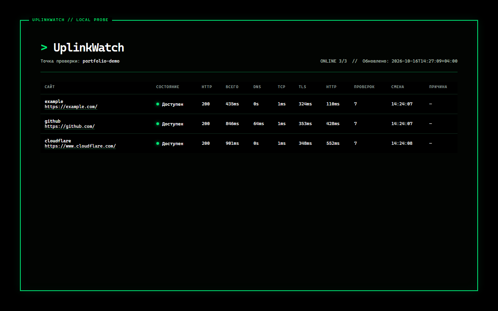
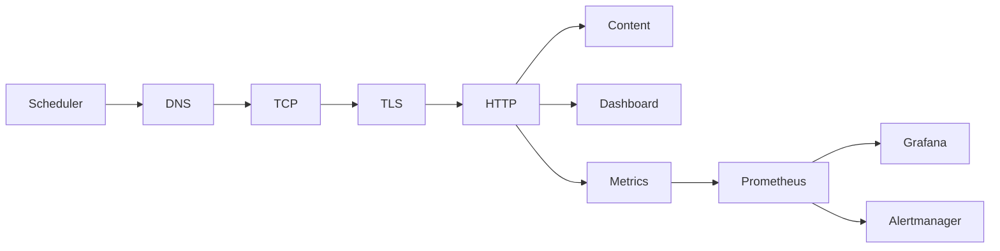
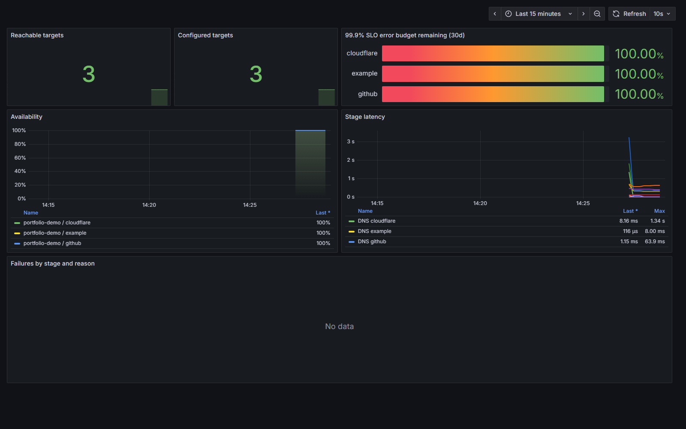

# UplinkWatch

UplinkWatch is a local website reachability monitor written in Go. It checks
the same network path used by the Windows computer running it and shows whether
a failure happened during DNS resolution, TCP connection, TLS negotiation,
HTTP response, or content validation.

The project is designed as a compact SRE portfolio project: the agent is useful
on its own, while the optional observability stack demonstrates metrics,
dashboards, alerting, SLOs, runbooks, CI, and release automation.



## Features

- staged DNS, TCP, TLS, HTTP, and content checks;
- clear failure reasons and a best-effort local diagnosis;
- terminal-style local dashboard;
- JSON result and diagnosis APIs;
- Prometheus metrics and a health endpoint;
- one privacy-conscious scanner for Arc, Chrome, Edge, Brave, and Firefox;
- Docker Compose stack with Prometheus, Grafana, and Alertmanager;
- provisioned Grafana dashboard, three alerts, runbooks, and a 99.9% demo SLO;
- tests on Windows and Linux through GitHub Actions;
- automated versioned Windows release archive with SHA-256 checksum.

Browser discovery keeps domain names and aggregate visit counts only. It does
not save page paths, titles, search queries, cookies, or response bodies.

## Quick start on Windows

The simplest path is a packaged GitHub release:

1. Download and extract `uplinkwatch-windows-amd64.zip`.
2. Open `scripts/windows`.
3. Double-click `Start Monitor.cmd`.
4. If no site list exists, UplinkWatch builds one from supported browser
   histories and saves it locally as `data/sites.json`.
5. Keep the console window open while monitoring is active.

The dashboard opens at `http://127.0.0.1:9876/`. Use
`Refresh Sites from Browsers.cmd` whenever the monitored list should be rebuilt.

## Build from source

Requirements:

- Go version declared in `go.mod`;
- Windows 10 or newer for the supplied `.cmd` scripts;
- Docker Desktop only for Prometheus, Grafana, and Alertmanager.

```powershell
go test ./...
New-Item -ItemType Directory -Force bin | Out-Null
go build -o bin/uplinkwatch.exe ./cmd/uplinkwatch
```

Then run `scripts/windows/Start Monitor.cmd`.

To use a manually maintained configuration instead of browser discovery:

```powershell
Copy-Item configs/uplinkwatch.example.json data/sites.json
bin/uplinkwatch.exe -config data/sites.json -open-browser
```

## Local endpoints

| Endpoint | Purpose |
| --- | --- |
| `http://127.0.0.1:9876/` | Current-state dashboard and local diagnosis |
| `http://127.0.0.1:9876/api/v1/results` | Latest check results as JSON |
| `http://127.0.0.1:9876/api/v1/diagnosis` | Best-effort diagnosis as JSON |
| `http://127.0.0.1:9876/metrics` | Prometheus metrics |
| `http://127.0.0.1:9876/healthz` | Agent process health |

## How checks work



Checks run concurrently with bounded response sizes and independent timeouts.
The diagnosis compares the latest result from every target. For example, a
failure affecting only one target is reported differently from DNS failure
affecting every target. This is evidence from one local probe, not proof that an
ISP or remote service is responsible.

## Browser discovery

One command handles every supported browser:

```powershell
bin/uplinkwatch.exe -discover-browsers -discovery-output data/sites.json
```

The generated list safely replaces the previous one instead of creating timestamped
backup files. `data/` is excluded from Git because its contents can reveal the
user's browsing habits.

## Observability stack

The Windows probe runs outside Docker so it observes the computer's real DNS
and network path. Prometheus, Grafana, and Alertmanager run in containers.

Double-click `scripts/windows/Start Everything.cmd`, or start only the
containers:

```powershell
docker compose -f deploy/docker-compose.yml up -d
```

Services:

- Grafana: `http://127.0.0.1:3000`
- Prometheus: `http://127.0.0.1:9090`
- Alertmanager: `http://127.0.0.1:9093`

The local demo permits anonymous Grafana viewing. Set
`GRAFANA_ADMIN_PASSWORD` in `.env` before using it outside a disposable local
environment. Starting the full stack binds the agent to `0.0.0.0:9876` so
Docker can scrape it; use that mode only on a trusted network.



## Alerts and SLO

The included alert rules cover:

- a target unavailable for five minutes;
- HTTP latency above 1.5 seconds for ten minutes;
- the UplinkWatch agent missing from Prometheus for two minutes.

Each alert links to a runbook in `docs/runbooks`. The demonstration SLO targets
99.9% successful checks over a rolling 30-day window, with recording rules and
a Grafana error-budget panel. See `docs/slo.md` for assumptions.

## Repository layout

```text
cmd/uplinkwatch/              application entry point
internal/checker/             staged network checks
internal/agent/               scheduling and concurrency
internal/config/              configuration loading and validation
internal/discovery/browser/   multi-browser history discovery
internal/status/              dashboard, APIs, diagnosis, and metrics
configs/                      safe example configuration
scripts/windows/              double-click Windows controls
deploy/                       local observability stack
docs/                         screenshots, SLO, and runbooks
.github/workflows/            CI and release automation
bin/                          local build output, ignored by Git
data/                         private generated site list, ignored by Git
```

## Development checks

```powershell
go fmt ./...
go vet ./...
go test ./...
go build ./cmd/uplinkwatch
docker compose -f deploy/docker-compose.yml config --quiet
```

Tags matching `v*` run the release workflow and publish a Windows archive plus
its SHA-256 checksum.

## Security and current limitations

- Only HTTP and HTTPS targets are accepted.
- The dashboard binds to loopback in monitor-only mode.
- Browser databases are copied to a temporary directory before reading.
- Local site lists, build outputs, working files, and secrets are ignored.
- Statistics are kept in memory and reset when the agent restarts.
- A single local probe cannot prove whether an outage belongs to the ISP or the
  remote service; an independent remote probe is future work.
- The Docker configuration is intended for local demonstration, not direct
  exposure to the internet.

Please report security issues according to `SECURITY.md`.

## License

MIT
